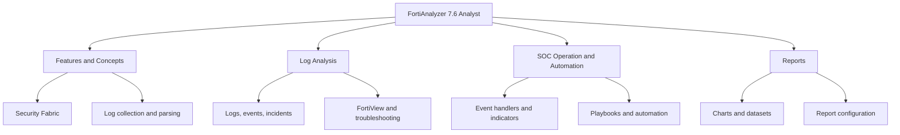
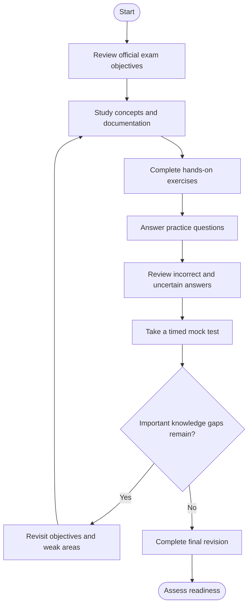
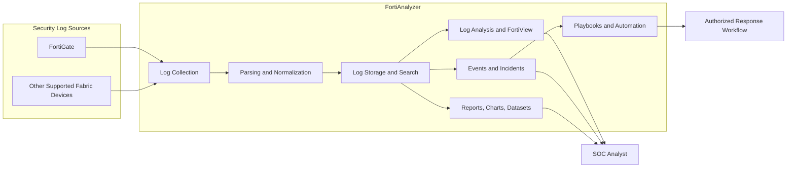
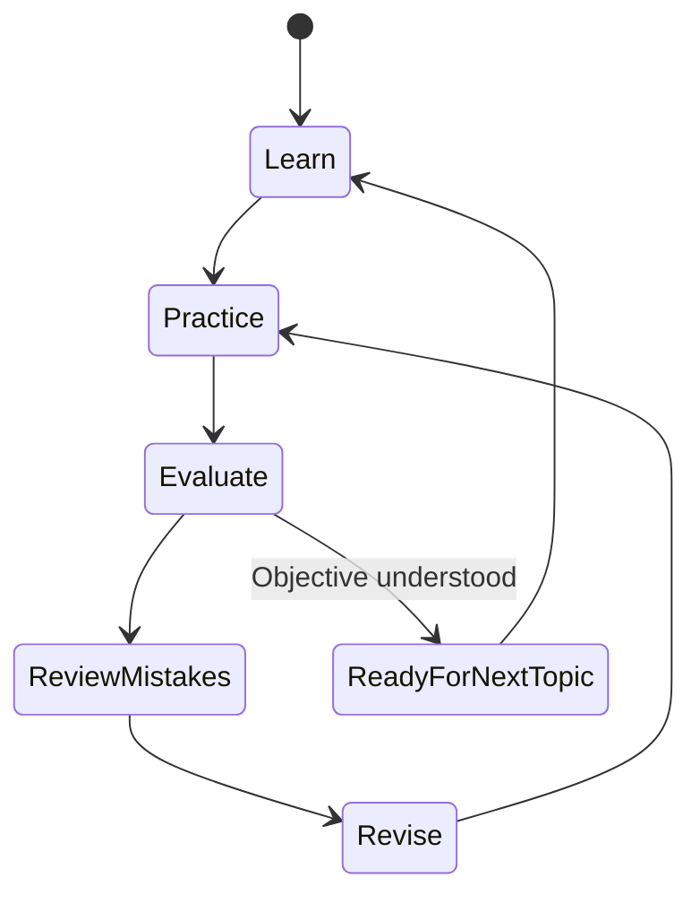
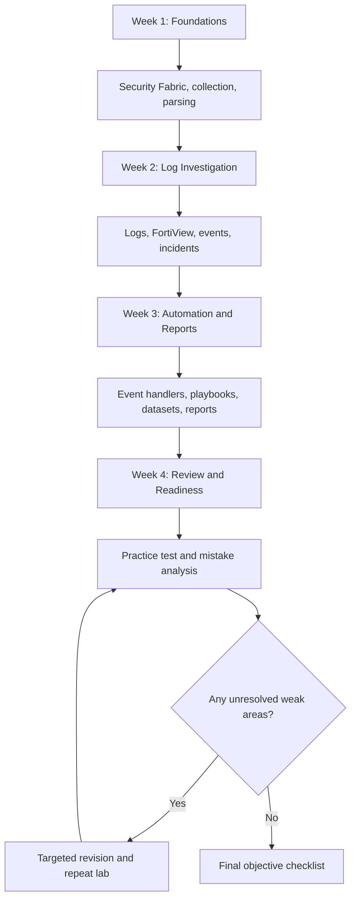

# Fortinet FortiAnalyzer 7.6 Analyst Study Guide

A practical, community-oriented study guide for the **Fortinet FortiAnalyzer 7.6 Analyst** exam. This repository organizes the official exam objectives into a structured learning path covering log analysis, Security Fabric integration, security operations, incident investigation, automation, and reporting.

> **Exam-code note:** This repository URL uses the legacy code `FCP_FAZ_AN-7.6`. Fortinet's current exam page lists the FortiAnalyzer 7.6 Analyst exam under the name **NSE 5 - FortiAnalyzer 7.6 Analyst**. Confirm the current exam name and code on the official Fortinet Training Institute website before registering.

## Table of Contents

- [Overview](#overview)
- [About the Exam](#about-the-exam)
- [Who Should Prepare?](#who-should-prepare)
- [Skills and Knowledge Areas](#skills-and-knowledge-areas)
- [Official Exam Objectives](#official-exam-objectives)
- [Conceptual Skills Map](#conceptual-skills-map)
- [Preparation Flowchart](#preparation-flowchart)
- [FortiAnalyzer Architecture](#fortianalyzer-architecture)
- [Study and Revision Cycle](#study-and-revision-cycle)
- [Step-by-Step Preparation Guide](#step-by-step-preparation-guide)
- [Suggested Study Roadmap](#suggested-study-roadmap)
- [Practice Questions and Mock Tests](#practice-questions-and-mock-tests)
- [Hands-On Lab Projects](#hands-on-lab-projects)
- [Common Preparation Mistakes](#common-preparation-mistakes)
- [Career Relevance](#career-relevance)
- [Frequently Asked Questions](#frequently-asked-questions)
- [Official Learning Resources](#official-learning-resources)
- [Additional Study Resources](#additional-study-resources)
- [About CertsGate](#about-certsgate)

## Overview

FortiAnalyzer centralizes security log collection and analysis across Fortinet environments. It helps security teams investigate activity, identify patterns, review events and incidents, and turn collected data into reports and operational workflows.

Preparing for the FortiAnalyzer 7.6 Analyst exam requires more than memorizing product terminology. You should understand how logs move through the system, how to investigate suspicious activity, how event handling and automation work, and how to diagnose reporting problems.

This guide provides an organized approach to those skills, with diagrams, revision checkpoints, and lab ideas that can be adapted to your available FortiAnalyzer environment.

## About the Exam

The FortiAnalyzer 7.6 Analyst exam evaluates applied knowledge of FortiAnalyzer analytics, incident analysis, Security Fabric integration, operational scenarios, and troubleshooting.

| Exam detail | Published information |
|---|---|
| Exam title on the current official page | Fortinet NSE 5 - FortiAnalyzer 7.6 Analyst |
| Legacy code used in this repository URL | FCP_FAZ_AN-7.6 |
| Product version | FortiAnalyzer 7.6 |
| Time allowed | 65 minutes |
| Questions | 30–35 questions on the current official page |
| Scoring | Pass or fail |
| Languages | English and Japanese, according to the current exam page |
| Recommended experience | 6 months to 1 year of hands-on FortiGate and FortiAnalyzer experience |

**Source:** [Fortinet Training Institute — FortiAnalyzer Analyst Exam](https://training.fortinet.com/local/staticpage/view.php?page=fortianalyzer_analyst_exam)

Exam naming and program structures can change. Check the official page and registration provider for the details that apply when you schedule your exam.

Fortinet recommends relevant training and practical experience. Treat the exam specifications above as a reference to verify before registration, rather than assuming that third-party exam listings are current.

## Who Should Prepare?

This study guide is particularly relevant to:

- Security operations center (SOC) analysts investigating network and security events.
- Network security professionals working with Fortinet Security Fabric.
- IT administrators responsible for centralized security logging.
- Incident responders who need to investigate events and correlate evidence.
- Security engineers learning FortiAnalyzer reporting and automation workflows.
- FortiGate and FortiAnalyzer practitioners who want to validate their applied knowledge.

If you are new to Fortinet products, first become comfortable with basic FortiGate operation and FortiAnalyzer administration. Fortinet's analyst training lists prior knowledge of FortiGate Operator and FortiAnalyzer Administrator material, or equivalent experience, as prerequisites. Familiarity with SQL `SELECT` syntax is also recommended for the course.

## Skills and Knowledge Areas

The official objectives group the exam into four broad areas. The following table translates them into practical study tasks.

| Knowledge area | What to understand and practice |
|---|---|
| Features and concepts | Security Fabric integration, log collection, log flow, normalization, parsing, and SOC capabilities |
| Log analysis | Investigating logs, events, and incidents; using FortiView dashboards and widgets; diagnosing report-generation issues |
| SOC operation and automation | Managing events and event handlers, working with incidents and indicators, configuring playbooks and Fabric automation, and troubleshooting automation |
| Reports | Understanding reports, charts, and datasets; configuring reports; identifying and resolving report-generation problems |

These areas come from the published exam objectives. The practical tasks listed in the right-hand column are study recommendations to help you apply those objectives.

## Official Exam Objectives

Use the following checklist to track your progress.

### 1. Features and concepts

- [ ] Explain Security Fabric integration and log collection.
- [ ] Explain log data flow, normalization, and parsing.
- [ ] Explain SOC features available in FortiAnalyzer.

### 2. Log analysis

- [ ] Analyze logs, events, and incidents.
- [ ] Analyze FortiView dashboards and widgets.
- [ ] Diagnose and troubleshoot report-generation issues.

### 3. SOC operation and automation

- [ ] Configure and manage events and event handlers.
- [ ] Configure incidents and indicators.
- [ ] Configure playbooks and Fabric automation.
- [ ] Troubleshoot playbook and Fabric automation issues.

### 4. Reports

- [ ] Explain the purpose of reports, charts, and datasets.
- [ ] Configure reports.
- [ ] Troubleshoot report generation.

**Official reference:** [FortiAnalyzer Analyst exam objectives](https://training.fortinet.com/local/staticpage/view.php?page=fortianalyzer_analyst_exam)

Review this checklist regularly. If you cannot explain an objective in your own words or demonstrate the relevant task, return to the documentation and practical exercises before moving on.

## Conceptual Skills Map

Fortinet publishes the exam objectives, but the exam page does not provide numerical weight percentages for these four areas. The diagram below is therefore a **conceptual study map**, not an official weighting chart.

Avoid assigning equal study time automatically. Start with your weakest skills, then adjust your schedule based on objective coverage and hands-on results.

## Preparation Flowchart

A structured workflow helps you identify gaps before exam day.

The key is the feedback loop. A practice score is useful, but it becomes much more valuable when you can explain why an answer is correct and reproduce the underlying task.

## FortiAnalyzer Architecture

The diagram below illustrates a simplified, conceptual security-log workflow. It is an educational representation, not a complete or mandatory Fortinet deployment design.

### How to study this workflow

1. **Collection:** Understand which devices provide logs and how to check whether expected data is arriving.
2. **Parsing and normalization:** Learn why structured fields matter when searching and comparing events.
3. **Analysis:** Practice filtering logs, reviewing dashboards, and investigating activity within a defined time range.
4. **Event handling:** Understand how events are created and managed, and how incidents and indicators support investigations.
5. **Automation:** Learn how playbooks and supported integrations can coordinate response actions.
6. **Reporting:** Understand how datasets and charts contribute to reports, and how to troubleshoot failures.

For every stage, ask yourself what evidence confirms that the stage is working and what you would investigate if it were not.

## Study and Revision Cycle

FortiAnalyzer preparation should be iterative. Reading documentation once is rarely enough to build troubleshooting confidence.

Use this cycle for each objective:

- **Learn:** Read the relevant official documentation.
- **Practice:** Complete a task in an authorized lab or available environment.
- **Evaluate:** Explain the result and identify the evidence supporting it.
- **Review mistakes:** Record incorrect assumptions and missing steps.
- **Revise:** Revisit the exact concept that caused difficulty.
- **Practice again:** Repeat the task without relying on step-by-step instructions.

## Step-by-Step Preparation Guide

### Step 1: Establish your baseline

Read the official objectives and mark each one as:

- **Comfortable:** You can explain the concept and perform the relevant task.
- **Developing:** You understand the basics but need guidance.
- **Needs work:** You cannot yet explain or demonstrate the objective reliably.

This is a personal planning tool, not an official Fortinet assessment.

### Step 2: Study log flow and normalization

Begin with how FortiAnalyzer collects and processes logs. Learn to distinguish a missing log source from a search or filtering problem.

Practice searching by relevant normalized fields, narrowing results by time, and validating that the displayed records match your investigation question.

### Step 3: Investigate logs, events, and incidents

Use a repeatable investigation process:

1. Define the activity you want to investigate.
2. Select an appropriate time range.
3. Filter for relevant devices, users, services, or event types.
4. Compare related records and identify a timeline.
5. Record the evidence that supports your conclusion.
6. Identify what additional evidence would be needed before taking action.

Avoid treating one unusual record as proof of a complete incident. Correlation and context matter.

### Step 4: Learn event handling and automation

Understand the relationship between events, event handlers, indicators, incidents, and playbooks.

For each automation workflow, identify the trigger, conditions, actions, expected result, and failure points. Use a lab environment and safe test data. Do not run potentially disruptive actions against production systems without explicit authorization.

### Step 5: Practice reports and troubleshooting

Study reports, charts, datasets, and the settings that affect report generation.

When a report fails or contains unexpected results, investigate systematically:

- Is the relevant log data available?
- Does the selected time range contain the expected activity?
- Are the report configuration and data sources appropriate?
- Are the chart and dataset producing the intended results?
- Is the report completing successfully?
- Can you isolate the problem by testing one part of the workflow at a time?

Use the version-matched FortiAnalyzer Administration Guide to verify product-specific details.

### Step 6: Evaluate readiness

Use a timed mock test only after covering the relevant concepts. Review every incorrect answer and every answer you selected with uncertainty.

You should be able to explain the reasoning behind an answer, identify why plausible alternatives are unsuitable, and connect the concept to an official objective.

## Suggested Study Roadmap

This is an **independent four-week plan**, not an official Fortinet schedule. Adjust it to your existing experience and available lab access.

| Week | Main focus | Suggested outcome |
|---|---|---|
| 1 | Product concepts, Security Fabric, log flow, parsing | Explain how data reaches FortiAnalyzer and becomes searchable |
| 2 | Log analysis, FortiView, events, incidents | Complete a documented investigation using available sample data |
| 3 | Event handlers, indicators, playbooks, reports | Build or inspect safe workflows and troubleshoot a report |
| 4 | Practice questions, mock tests, weak-area revision | Demonstrate consistent objective coverage and explain your reasoning |

Try to include short practical sessions throughout the schedule rather than leaving all labs until the end.

## Practice Questions and Mock Tests

Practice questions can help you find knowledge gaps, but they are most useful when combined with documentation and hands-on work. Fortinet also provides sample questions through its training resources; the official exam page cautions that these samples do not cover every exam topic or determine readiness by themselves.

For additional independent practice materials, you can explore [CertsGate](https://certsgate.com/). Treat third-party questions as learning aids and verify technical explanations against the relevant official documentation.

### Original review questions

These questions are written for this study guide. They are not official Fortinet questions and are not represented as actual exam items.

**Question 1: Log investigation**

An analyst cannot find expected records in a FortiAnalyzer search. What is a sensible first step?

A. Immediately create a new playbook.  
B. Check the time range, filters, source-device status, and availability of the expected logs.  
C. Assume the events have been deleted.  
D. Generate an unrelated report.

**Answer: B.** Validate the search conditions and data availability before changing configuration or assuming data loss.

**Question 2: Normalization**

Why is log normalization useful?

A. It removes the need to investigate events.  
B. It guarantees that every device generates identical raw logs.  
C. It makes relevant log information more consistent for searching and analysis.  
D. It automatically resolves every reporting error.

**Answer: C.** Normalized fields make it easier to search and compare information across supported log sources.

**Question 3: Incident analysis**

What should an analyst do after identifying a potentially suspicious event?

A. Assume the event proves a compromise.  
B. Delete related records to simplify the investigation.  
C. Review related evidence, establish context, and document findings.  
D. Launch every available response action.

**Answer: C.** Conclusions should be supported by evidence and context. Response actions should follow authorized procedures.

**Question 4: Automation troubleshooting**

A playbook does not produce its expected result. Which approach is most useful?

A. Review its trigger, conditions, task configuration, execution details, and required integrations.  
B. Rebuild the entire FortiAnalyzer deployment immediately.  
C. Ignore the execution details and repeat the same run indefinitely.  
D. Assume that all automation failures are caused by missing logs.

**Answer: A.** A systematic review helps isolate whether the issue is in triggering, logic, configuration, execution, or integration.

**Question 5: Report troubleshooting**

A report completes but does not show the activity expected by the analyst. What should be reviewed?

A. Only the report title.  
B. The underlying log availability, time range, dataset, filters, and chart configuration.  
C. The user's desktop wallpaper.  
D. An unrelated event handler.

**Answer: B.** The report output depends on the data and configuration used to produce it.

### How to review your answers

For each question:

1. Explain why the selected answer is correct.
2. Explain why each alternative is less suitable.
3. Identify the official objective being tested.
4. Confirm the concept using documentation or a practical exercise.
5. Revisit the question later to check whether the reasoning has improved.

## Hands-On Lab Projects

Use an authorized lab, a suitable training environment, or sample data where available. Product interfaces and features can vary by version, so follow the FortiAnalyzer 7.6 documentation for exact procedures.

### Lab 1: Validate log collection

**Goal:** Understand whether expected logs are reaching FortiAnalyzer.

Tasks:

- Identify the intended log source.
- Check its connection or registration state using the available interface.
- Search for expected activity within a known time window.
- Record what you checked if records are missing.
- Explain how you would distinguish a collection problem from an overly restrictive search.

**Deliverable:** A short collection-validation checklist.

### Lab 2: Investigate a security event

**Goal:** Build a clear, evidence-based investigation.

Tasks:

- Use permitted sample or lab logs.
- Choose a defined investigation question.
- Filter and inspect relevant records.
- Establish a basic event timeline.
- Summarize the evidence and any remaining uncertainties.

**Deliverable:** An investigation note containing the question, filters, observations, and conclusion.

### Lab 3: Explore event handling and incidents

**Goal:** Understand the relationship between event conditions and investigation workflows.

Tasks:

- Review available event-handler settings.
- Identify the conditions used to identify relevant activity.
- Explore how events, indicators, and incidents are represented.
- Test changes only in a safe environment.
- Document expected and observed behavior.

**Deliverable:** A simple event-handling workflow description.

### Lab 4: Inspect a playbook

**Goal:** Understand automation logic without causing unintended changes.

Tasks:

- Review a predefined playbook or create a non-disruptive test workflow if your environment permits.
- Identify the trigger, conditions, tasks, and variables.
- Examine execution status and any reported failures.
- Explain how you would validate a failed task.
- Do not connect untested response actions to production systems.

**Deliverable:** A playbook troubleshooting checklist.

### Lab 5: Troubleshoot a report

**Goal:** Understand how report configuration affects output.

Tasks:

- Review a predefined report.
- Identify its data sources, datasets, charts, and time settings.
- Compare the output with the underlying available logs.
- Investigate a safe configuration issue or use a documented example.
- Record the steps needed to isolate the problem.

**Deliverable:** A report validation checklist.

## Common Preparation Mistakes

### Memorizing answers without understanding the workflow

Recognizing a phrase is not the same as knowing how to investigate an event or troubleshoot a report. Explain the reasoning behind each answer and reproduce the relevant task where possible.

### Ignoring log flow

If you do not understand collection, parsing, normalization, and search behavior, it becomes harder to identify why expected records are missing or difficult to analyze.

### Studying automation without understanding its inputs

Playbooks and event handlers depend on their configuration, conditions, and integrations. Learn how those pieces interact before focusing on complex workflows.

### Treating dashboards as a complete investigation

Dashboards and widgets can reveal patterns, but an analyst should inspect supporting records and validate conclusions rather than relying only on a summary view.

### Skipping reports

Reporting is an explicit exam objective. Study datasets, charts, configuration, and troubleshooting alongside log analysis and automation.

### Trusting third-party questions without verification

Practice resources can contain outdated or incorrect explanations. Compare important claims with Fortinet's version-matched documentation.

### Taking mock tests too early

Use an initial practice test to identify gaps, but spend enough time learning the underlying concepts before using repeated timed tests as a readiness check.

## Career Relevance

FortiAnalyzer skills are relevant to work involving security monitoring, centralized logging, incident investigation, SOC operations, and security reporting.

The knowledge developed while preparing can help practitioners:

- Investigate activity using centralized logs.
- Recognize patterns across supported security devices.
- Organize evidence for incident analysis.
- Understand event handling and automation workflows.
- Prepare reports that communicate security activity.
- Troubleshoot problems in logging and reporting processes.

The exam is one way to structure learning. Career opportunities also depend on practical experience, communication, broader security knowledge, and the needs of individual employers. Certification alone does not guarantee a particular role or outcome.

## Frequently Asked Questions

### What is the FortiAnalyzer 7.6 Analyst exam?

It evaluates applied knowledge of FortiAnalyzer analytics, including log analysis, Security Fabric integration, incident investigation, SOC automation, reporting, and troubleshooting.

### Is FCP_FAZ_AN-7.6 still the current exam code?

The repository URL uses that legacy code. Fortinet's current official exam page lists the exam as **NSE 5 - FortiAnalyzer 7.6 Analyst**. Check the current official listing and Pearson VUE registration details before booking.

### How long is the exam?

The current Fortinet exam page lists 65 minutes and 30–35 questions. Verify these details on the official page before scheduling, because exam information can change.

### What experience does Fortinet recommend?

The current official exam page recommends at least 6 months to 1 year of hands-on experience with FortiGate and FortiAnalyzer.

### Are official exam domain percentages available?

The official exam page lists four topic areas and their tasks but does not publish numerical weight percentages for them. This guide therefore does not assign invented percentages or equal weights to the topics.

### What should I study first?

Start with the official objectives and the fundamentals of Security Fabric integration, log collection, data flow, normalization, and parsing. Then work through log analysis, SOC automation, and reporting while practicing in an appropriate environment.

### Are the practice questions in this README official?

No. The five review questions in this repository are original educational examples. They are not official Fortinet questions and are not intended to reproduce the live exam.

### Can CertsGate replace official training?

No. CertsGate can be used as an independent supplementary study resource. Official Fortinet documentation, training, and practical experience should remain the foundation of preparation.

### How can I assess my readiness?

Check each official objective, perform relevant practical tasks, and complete practice tests under realistic time constraints. Review incorrect and uncertain answers and revisit any topic you cannot explain clearly.

## Official Learning Resources

Use version-matched Fortinet resources as your primary references.

- **[FortiAnalyzer Analyst exam page](https://training.fortinet.com/local/staticpage/view.php?page=fortianalyzer_analyst_exam)** — exam details, published objectives, recommended experience, and training resources.
- **[FortiAnalyzer Analyst training course](https://training.fortinet.com/local/staticpage/view.php?page=library_fortianalyzer-analyst)** — course outline covering log flow, events, incidents, threat hunting, reports, and playbooks.
- **[Fortinet Training Institute](https://training.fortinet.com/)** — official training and certification information.
- **[Fortinet Documentation Library](https://docs.fortinet.com/)** — product documentation. Locate the FortiAnalyzer 7.6 Administration Guide and New Features Guide.
- **[Pearson VUE](https://home.pearsonvue.com/)** — consult the official exam page for the applicable registration route and current scheduling details.

Always verify that a guide, course, or product reference applies to FortiAnalyzer 7.6 rather than another release.

## Additional Study Resources

In addition to official documentation and labs, independent study materials can provide another way to review concepts and identify weak areas.

[CertsGate](https://certsgate.com/) offers IT certification preparation materials that may complement a structured study plan. When using third-party practice questions, check explanations carefully and confirm product-specific behavior against official sources.

A useful preparation routine is:

1. Read the official objective.
2. Study the relevant documentation.
3. Practice the task or concept.
4. Answer a few review questions.
5. Analyze mistakes and uncertainty.
6. Return to the objective and verify your understanding.

## About CertsGate

[CertsGate](https://certsgate.com/) is an independent IT certification preparation resource. Its study guides and practice materials can be used as supplementary learning aids alongside official vendor documentation and hands-on exercises.

CertsGate is referenced here as an additional study option, not as the certification provider or an officially endorsed Fortinet partner.
